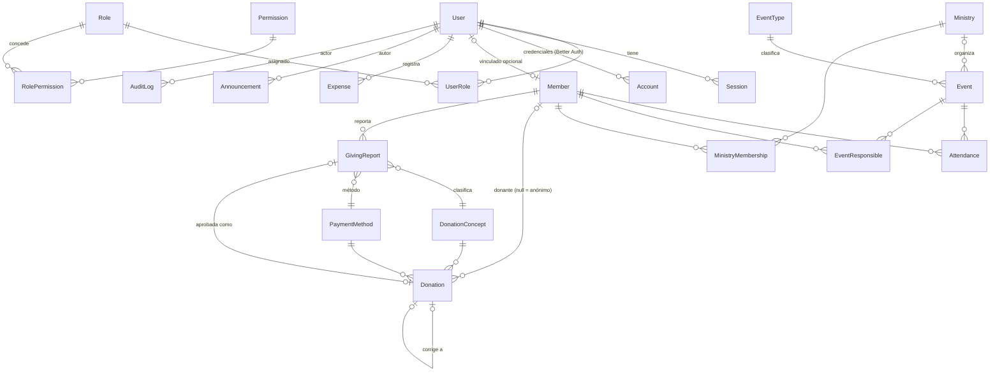

# Modelo de datos (propuesta inicial)

PostgreSQL + Prisma. Identificadores `cuid2` (texto). Fechas `timestamptz` en UTC. Montos `numeric(12,2)`.

## Diagrama

## Entidades

| Entidad | Campos clave | Reglas |
|---|---|---|
| **User** | id, email (único), name, isActive, createdAt | Tabla de Better Auth extendida. Desactivar ⇒ revocar sesiones. |
| Account / Session / Verification | (Better Auth) | Hash de contraseña en `Account.password`. `Verification` guarda tokens de recuperación (un uso, vencimiento). |
| **Role** | id, key (`ADMIN`,`PASTOR`,`SECRETARY`,`TREASURER`,`COORDINATOR`), name, isSystem | Roles del sistema no se borran. |
| **Permission** | id, key (`members:read`, `finance:void`…) | Catálogo sembrado por migración/seed. |
| RolePermission | roleId, permissionId (PK compuesta) | Matriz configurable (ver `permisos.md`). |
| UserRole | userId, roleId, assignedById, assignedAt | `assignedById ≠ userId` (validado en servicio). |
| **Member** | id, firstName, lastName, searchName (normalizado sin acentos), phone?, email? (único parcial), joinDate?, status (`VISITOR`/`ACTIVE`/`INACTIVE`), position? (cargo), isMinor, notes?, createdById, updatedById, timestamps | Índices: `searchName`, `status`. Sin borrado físico. |
| **EventType** | id, name, isActive | Configurable (culto, ensayo, reunión…). |
| **Event** | id, title, typeId, startsAt, endsAt, location?, description?, visibility (`PUBLIC`/`PRIVATE`), status (`SCHEDULED`/`CANCELLED`/`COMPLETED`), ministryId?, visitorCount (int ≥ 0), cancelledReason?, timestamps | CHECK `endsAt > startsAt`. Índice `startsAt`, `(visibility,status,startsAt)`. |
| EventResponsible | eventId, memberId (PK compuesta) | Responsables del evento. |
| **Attendance** | id, eventId, memberId, status (`PRESENT`/`ABSENT`), recordedById, recordedAt, updatedAt | UNIQUE `(eventId, memberId)`. Sin fila = pendiente. |
| **Ministry** | id, name (único), description?, isActive, timestamps | Configurable. |
| **MinistryMembership** | id, ministryId, memberId, role (`MEMBER`/`COORDINATOR`), startDate, endDate? | Activa si `endDate IS NULL`. Índice único parcial `(ministryId, memberId) WHERE endDate IS NULL` (vía SQL en migración). |
| **DonationConcept** | id, name, isActive | Diezmo, ofrenda, misiones… |
| **PaymentMethod** | id, name, isActive | Efectivo, transferencia… |
| **Donation** | id, receivedAt (date), amount `numeric(12,2)` CHECK > 0, currency (`MXN`), conceptId, methodId, memberId?, reference?, notes?, status (`VALID`/`VOIDED`), voidedAt?, voidedById?, voidReason?, correctsId?, createdById, createdAt | Nunca `DELETE`. Anulación requiere motivo. Totales solo suman `VALID`. |
| **GivingReport** | id, receivedAt, amount, currency, conceptId, methodId, memberId, submittedById, isAnonymous, status (`PENDING`/`APPROVED`/`REJECTED`), reviewedAt?, reviewedById?, reviewNote?, donationId? | Envío de una ofrenda ya entregada, no procesa pagos. Solo una aprobación de tesorería crea el ingreso oficial. Se oculta la identidad en reportes anónimos. |
| **Expense** | id, spentAt, amount, currency, category, description, method, reference?, notes?, status (`VALID`/`VOIDED`), voidedAt?, voidedById?, voidReason?, createdById | Registro de egreso; no se borra físicamente. Anulación requiere motivo. El corte semanal resta solo egresos vigentes. |
| **Announcement** | id, title, body (texto plano/markdown sanitizado), authorId, visibility, isFeatured, publishedAt?, expiresAt?, status (`DRAFT`/`PUBLISHED`/`ARCHIVED`), timestamps | Públicos vigentes = `PUBLISHED ∧ PUBLIC ∧ (expiresAt null ∨ > ahora)`. |
| **ChurchSettings** | id (fila única `"default"`), name, logoPath?, address?, phone?, email?, timezone (`America/Mexico_City`), currency (`MXN`), aboutText?, scheduleText?, terminology (JSON), updatedById | Una fila. |
| **AuditLog** | id, actorId?, action (`donation.void`…), entityType, entityId, metadata (JSON sin secretos), ip?, createdAt | Solo inserción. Índice `(entityType, entityId)`, `createdAt`. |

## Datos históricos

- Asistencia y aportaciones referencian a `Member` por id; **no** copian nombre/teléfono. Como los miembros no se borran físicamente, el historial siempre se puede resolver.
- `AuditLog.metadata` guarda **qué campos cambiaron** (y valores anteriores/nuevos de campos no sensibles) para reconstruir correcciones.

## Reglas de eliminación y conservación

| Entidad | Operación ordinaria | Borrado físico |
|---|---|---|
| Member | Desactivar | Solo por solicitud de cancelación de datos (derechos ARCO) mediante proceso administrativo futuro que anonimiza. |
| Donation | Anular | Nunca desde la aplicación. |
| GivingReport | Aprobar o devolver a revisión | No se elimina; aprobada crea una aportación inmutable asociada. |
| Expense | Anular | Nunca desde la aplicación. |
| Event | Cancelar | No. |
| Announcement | Archivar | No en v1. |
| Attendance | Editar estado | Se puede borrar una marca capturada por error (vuelve a "pendiente"), auditado. |
| AuditLog | — | Nunca desde la aplicación. |

## Transacciones

Usar `prisma.$transaction` en: captura masiva de asistencia, corrección de aportación (anular + crear), asignación de roles (+ auditoría), cambios de coordinador.
# Extensión multiiglesia (fase incremental)

La base actual conserva los módulos operativos existentes y añade una capa no destructiva para crecer como franquicia:

- `Franchise` agrupa varias sedes.
- `Church` representa una iglesia/sede con identificador único.
- `ChurchProfile` guarda colores, tipografía, textos, contacto, zona horaria y terminología propia de cada sede.
- `ChurchMembership` permite que un usuario pertenezca a varias iglesias.
- `ChurchRoleAssignment` prepara la asignación de un rol por iglesia.

Esta primera fase no migra ni reescribe los módulos existentes. La separación de miembros, eventos, asistencia, ministerios, aportaciones y comunicados por `churchId` debe hacerse módulo por módulo, con datos de migración y validación de alcance. Así se mantiene funcional el sistema actual mientras se incorpora la estructura de franquicia.
